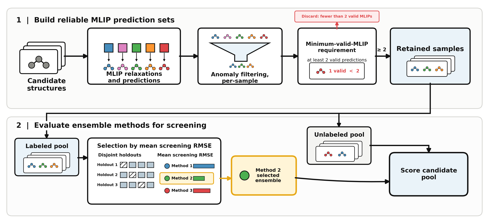

# Oasis

How can limited quantum-mechanical reference data help evaluate and improve AI
predictions for catalysis? Oasis explores this question through adsorption
energy—how strongly an atom or molecule binds to a surface, a useful quantity
for comparing candidate catalysts.

Density functional theory (DFT) supplies reference energies, but its computational
cost limits coverage. Machine-learned interatomic potentials (MLIPs) predict
atomic energies and forces from models trained on reference calculations,
making screening more affordable while accuracy varies across chemical systems.

Oasis compares ways to combine or correct MLIP predictions using sparse DFT
data. It measures how prediction error changes with reference-data availability
and evaluates method selection under limited budgets; improvements depend on
the method and dataset.



## Capabilities

- Compare unfitted baselines, regression corrections, and ensembles through
  learning curves.
- Evaluate screening policies for selecting ensemble methods with limited
  reference data.
- Examine predictive spread, optional uncertainty calibration, and the tradeoff
  between computation time and prediction error.
- Reuse compatible result bundles, extend sweeps incrementally, and regenerate
  plots without repeating every fit.

Experiments use explicit configurations, seeds, and recorded per-point
provenance. Model selection uses training/validation data; outer test data stay
held out for final evaluation. Uncertainty estimates and timing comparisons have
specific limits, documented in the [technical guides](docs/README.md).

<a id="environment"></a>

## Quickstart

Requires Python 3.10 or later. From a checkout of this repository, install the
project and development dependencies:

```bash
pip install -e ".[dev]"
```

For an environment resolved from the committed lockfile, use `uv sync --extra dev`
instead, then activate `.venv`. See [GPU setup](docs/gpu_setup.md) for CUDA.

Copy [experiment.example.toml](experiment.example.toml) to `my-experiment.toml`.
Set its dataset paths, model choices, and device for your study. You must supply
reference data and precomputed MLIP results; the template includes placeholder
paths and optional feature artifacts. Follow [input preparation](docs/getting_started.md#prepare-a-study)
before running:

```bash
python -m oasis my-experiment.toml
```

The run produces result artifacts and plots under `data/results/` by default.
For the Python API, configuration details, and test commands, see
[Running experiments](docs/getting_started.md).

## Documentation

- [Quickstart](#quickstart) and [Running experiments](docs/getting_started.md):
  installation, input preparation, and Python/CLI usage.

<a id="learning-curve-result-artifacts"></a>
<a id="uncertainty-metrics"></a>
<a id="oh-bma-comparison-workflow"></a>

- [Technical guides](docs/README.md): the full index for experiment configuration,
  results, uncertainty, filtering, and timing.

<a id="entrypoints"></a>
<a id="graph-artifact-contract"></a>
<a id="learned-sweep-contract"></a>
<a id="split-feasibility-policy"></a>

- Developer references: [tests](docs/getting_started.md#tests),
  [evaluation contracts](docs/evaluation_protocol.md), and
  [cache internals](docs/comparative_learning_cache_model.md).

<a id="related-repo"></a>

## Related projects

| Project | Role |
| --- | --- |
| [**Intergen**](https://github.com/SiliconScientist/intergen) | Generates candidate atomic structures and adsorption sites. |
| [**Moira**](https://github.com/SiliconScientist/Moirai) | Runs MLIP predictions and extracts prediction anomalies to support prediction reliability tests and abstention decisions. |
| **Oasis** | Evaluates and adapts predictions using limited reference data, including experiments with anomaly-aware filtering. |

These projects have complementary roles but do not form an automatically
integrated pipeline; connecting their workflows requires separate setup.
